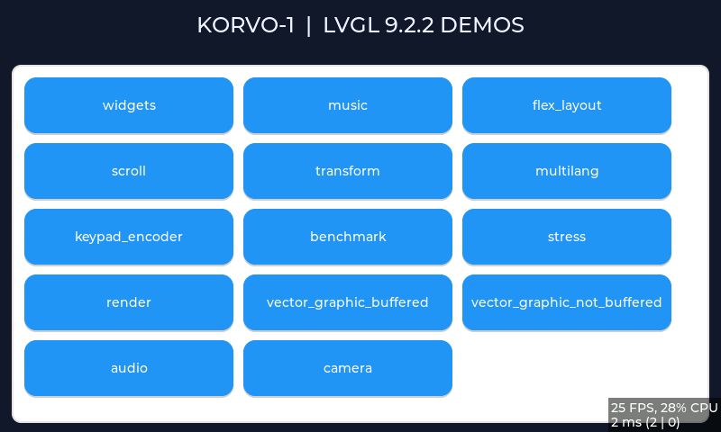

# ESP32-S31 Linux PPA / 2D-DMA와 LVGL

이 구성은 화면 출력과 UI 렌더링을 모두 **800×480 RGB565**로 유지합니다. ESP-IDF 전용 API 대신 Linux 커널 모듈 `esp32s31_ppa.ko`와 LVGL 9.2.2용 draw unit을 구현했습니다. 드라이버 로드만으로 모든 LVGL 명령이 빨라지는 것은 아닙니다. 아래 지원 조건에 맞는 작업만 가속기에 보내며 나머지는 기존 LVGL 소프트웨어 렌더러가 처리합니다.

## 공식 Korvo-1 펌웨어에서 참고한 부분

사용자가 제공한 [공식 Korvo-1 BSP](https://github.com/espressif/esp-bsp/tree/master/bsp/esp32_s31_korvo_1)와 [LVGL 데모 설정](https://github.com/espressif/esp-bsp/blob/master/examples/display_lvgl_demos/sdkconfig.bsp.esp32_s31_korvo_1)을 확인했습니다. 공식 예제는 `DIRECT_MODE`, RGB framebuffer 2개, bounce buffer, performance monitor를 선택합니다. BSP의 기본 시작 함수는 DMA용 내부 메모리 버퍼를 요청합니다. 예제 설정과 BSP 기본값은 구분해야 합니다.

현재 Linux에서는 framebuffer를 직접 CPU로 쓰던 방식에서, **캐시가 가능한 전체 화면 canvas에 그린 뒤 변경 영역만 DMA2D로 LCD framebuffer에 복사**하는 방식으로 변경했습니다. 부분 렌더링에서 같은 이미지/효과의 draw task를 여러 타일마다 반복하는 비용을 줄이기 위한 변경입니다. LCD의 scanout framebuffer와 렌더링 canvas는 서로 분리되어 있습니다. LCD VSYNC에 맞춘 이중 scanout buffer 교환이나 공식 bounce-buffer ISR 자체를 이식한 것은 아니며, 화면 찢김 방지를 보장하지 않습니다.

공식 `esp_lvgl_port`의 PPA 설정은 화면 회전용 옵션입니다. 이 저장소의 채우기·합성 draw unit은 별도로 구현한 Linux 연동이며, 공식 BSP가 모든 UI를 PPA로 렌더링한다고 가정하지 않습니다. 현재 PPA SRM 확대·회전·미러링과 임의 각도 이미지 변환은 이 draw unit의 지원 범위에 포함하지 않습니다.

## 실제 가속 경로

| 작업 | 처리 경로 | 조건 |
|---|---|---|
| 단색 배경 채우기 | PPA Fill | 완전 불투명, gradient 없음, 사각형 또는 둥근 사각형의 모서리가 없는 중앙 영역 |
| RGB565 이미지 복사 | 2D-DMA | 원본 크기, 일반 합성, 색상 재지정/마스크 없음 |
| RGB565 고정 투명도 합성 | PPA Blend | 위와 같은 조건, 전역 opacity 적용 |
| ARGB8888 이미지 합성 | PPA Blend | 픽셀 alpha 및 전역 opacity, premultiplied 입력 제외 |
| 변경 영역을 LCD framebuffer로 복사 | 2D-DMA | canvas의 stride와 사각형 좌표를 사용하며 CPU의 비캐시 framebuffer 복사를 대체 |
| 글자·그림자·gradient·곡선·변환 이미지·복합 마스크·다른 색 형식 | LVGL software | 화면 내용과 효과를 유지 |

작은 작업은 장치 호출 비용을 고려해 512픽셀 이상부터 선택합니다. RGB565 DMA 수신은 32비트 쓰기 정렬이 필요하므로 홀수 폭/목적지 좌표의 작업은 소프트웨어가 담당합니다. 무효화 영역은 가로 2픽셀 경계로 확장합니다. 이는 해상도 축소가 아닙니다. 지원하지 않는 offscreen layer도 소프트웨어로 그립니다.

CPU와 DMA가 함께 사용하는 메모리에는 Linux DMA API로 캐시 clean/invalidate를 수행합니다. RISC-V 플랫폼 장치의 기본 coherent 설정과 `dma_skip_sync`가 실제 하드웨어와 맞지 않아, probe에서 비일관성 DMA 장치로 명시했습니다. 완료 신호만 확인하지 않고 실제 복사 픽셀과 주변 영역 보존을 검사했습니다. 짧은 DMA 완료를 기다릴 때 매번 한 scheduler tick을 기다리지 않도록 짧게 polling하고, 긴 전송만 sleep으로 전환합니다.

## 메모리와 다른 장치

| 물리 주소 | 용도 |
|---|---|
| `0x50DB8000`부터 `0xC0000` 바이트 | 캐시 가능한 LVGL DIRECT canvas. 부팅 시 예약해 연속 메모리 단편화 회피 |
| `0x50F40000`부터 `0xC0000` 바이트 | 기존 LCD framebuffer와 단색 검사 타일 |
| `0x2F079000`부터 `0xC00` 바이트 | LCD AXI-GDMA TX0 descriptor |
| `0x2F079C00`부터 `0x200` 바이트 | 카메라 AXI-GDMA RX1 descriptor. 실제 29개×16=464바이트 |
| `0x2F079E00`부터 `0x200` 바이트 | PPA / 2D-DMA descriptor |

PPA와 2D-DMA는 LCD·카메라의 AXI-GDMA 및 오디오의 AHB-GDMA와 별도 블록입니다. 기존 LCD/카메라 전역 DMA reset을 사용하지 않습니다. canvas는 약 768KiB의 일반 RAM을 추가로 예약하므로 복잡한 데모에서는 swap 사용량도 함께 확인해야 합니다. 부트로더의 framebuffer 주소는 유지합니다.

## 보드 사용법과 성능 표시

부팅 서비스 `/etc/init.d/S54ppa`가 모듈을 로드하고, 메뉴 및 `audio` 플레이어가 같은 가속 포트를 사용합니다. 모듈이나 전용 버퍼를 사용할 수 없으면 기존 소프트웨어 framebuffer 포트로 시작합니다. 전송 오류가 발생하면 해당 프로세스는 경고를 기록하고 소프트웨어로 계속 그립니다.

```sh
cat /var/log/ppa.log
ls -l /dev/esp32s31-ppa
ppa-test --stats
cat /var/log/korvo-ui.log
```

`LV_USE_SYSMON=1`, `LV_USE_PERF_MONITOR=1`, `LV_USE_PERF_MONITOR_LOG_MODE=0`으로 빌드했습니다. 화면 오른쪽 아래 FPS와 CPU 표시가 나타납니다. CPU 값은 LVGL timer의 busy/idle 계측으로 계산되며 Linux 전체 시스템의 CPU 사용률과 같지 않습니다. 패널의 물리 주사율도 LVGL FPS와 다른 값입니다.



`fbset`의 `accel false`는 fbdev의 전통적인 가속 인터페이스 표시입니다. 이 구현은 별도 `/dev/esp32s31-ppa`를 통해 LVGL이 직접 요청하므로, 실제 사용 여부는 `ppa-test --stats`로 확인합니다.

LCD 클럭은 공식 BSP와 대조하고 하드웨어 레지스터를 읽어 다시 확인했습니다. `HP_SYS_CLKRST.LCDCAM_LCD_CTRL0=0x0716483D`, `LCD_CLOCK=0x80000141`이며, PLL160M에서 `N=8`, `B=201`, `A=226`, 픽셀 prescale=1로 나누어 **17,999,004Hz**입니다. 공식 18MHz에서 약 0.006% 이내 차이입니다. H total=928, V total=548이고 계산 주사율은 약 35.39Hz입니다. H pulse/back/front=40/40/48, V pulse/back/front=23/32/13, PCLK 하강 에지도 [공식 정의](https://github.com/espressif/esp-bsp/blob/master/bsp/esp32_s31_korvo_1/include/bsp/esp32_s31_korvo_1.h)와 일치합니다. 이 레지스터 검사는 별도 계측기로 GPIO 클럭을 측정한 결과는 아닙니다.

비교 실행은 GUI 서비스를 멈춘 뒤 하나씩 수행합니다. 테스트 중에는 화면을 터치하지 않습니다.

```sh
/etc/init.d/S97lvgl-music-demo stop
# 기존 CPU 렌더링 + CPU framebuffer 복사
KORVO_PPA_DISABLE=1 KORVO_UI_STATS=1 korvo-ui music 15
# PPA + DMA2D, 작은 타일을 쓰는 비교 경로
KORVO_PPA_PARTIAL=1 KORVO_UI_STATS=1 korvo-ui music 15
# 기본 전체 화면 DIRECT canvas 경로
KORVO_UI_STATS=1 korvo-ui music 15
ppa-test --stats
/etc/init.d/S97lvgl-music-demo start
```

`KORVO_UI_STATS`는 실제 flush가 발생한 갱신 20회를 집계하며 종료할 때 가속 명령 수와 오류 수를 출력합니다. 어떤 화면에서 실제로 가속했는지는 `copy/fill/flush/blend` 증가로 확인할 수 있습니다. 특정 장면에서 fill이 0일 수 있으며, 확대·변환된 이미지가 많은 구간은 여전히 CPU의 영향을 받습니다.

2026-11-19 보드 커널 `#6`에서 FPS 모니터를 켠 동일 실행 파일로 위 세 명령을 순서대로 실행한 결과입니다. 각 모드의 **첫 실제 갱신 20회**를 비교했습니다.

| 경로 | 구간 시간(대기 포함) | 처리 시간 | framebuffer flush 시간 |
|---|---:|---:|---:|
| Software | 6,282ms | 3,930ms | 892ms |
| PPA + DMA2D / partial | 4,281ms | 2,529ms | 163ms |
| PPA + DMA2D / DIRECT | 3,234ms | 1,454ms | 166ms |

이 구간의 DIRECT 처리 시간은 software 대비 약 **63%**, partial 가속 대비 약 **43%** 감소했습니다. flush 시간은 software 대비 약 **81%** 감소했습니다. 구간 시간 전체가 처리 시간과 같지는 않습니다. 데모의 타이머, 메모리/cache 상태, swap, FPS 오버레이의 갱신도 결과에 영향을 줍니다. 이는 시작 구간 한 번의 비교이며 모든 데모의 고정 배속이나 60FPS를 뜻하지 않습니다. 기본 메뉴의 성능 오버레이 캡처에서는 25FPS가 표시됐지만, 정적 메뉴의 갱신 빈도로 음악 애니메이션의 FPS를 추정하면 안 됩니다.

DIRECT 음악 실행 동안 실제 하드웨어 명령은 `fill=78`, `flush=78`, `blend=81`, `errors=0`이었습니다. 따라서 화면 복사뿐 아니라 합성 경로도 사용됐음을 확인했습니다.

## 정확도 검사

```sh
/etc/init.d/S97lvgl-music-demo stop
ppa-test
/etc/init.d/S97lvgl-music-demo start
```

`ppa-test`는 stride/crop 복사, RGB565 5색 채우기, 고정 alpha와 픽셀 alpha 합성, 범위 초과 요청 거부를 검사합니다. CPU로 만든 기준값과 픽셀을 비교하며 대상 사각형 밖의 보존도 확인합니다. 기본 검사는 LCD 내용을 바꾸지 않습니다. GUI 실행 중에는 전용 workspace 소유권 때문에 `EBUSY`가 정상이며 `--stats`는 동시 실행 가능합니다.

`tests/ppa-lvgl-scene.c`는 실제 LVGL draw dispatch와 flush까지 검사하는 고정 장면입니다. 대상 toolchain으로 `korvo_ppa_lvgl.c`와 함께 빌드하고 LVGL/ThorVG 라이브러리를 링크합니다. GUI를 멈춘 뒤 소프트웨어와 하드웨어로 각각 실행해 캡처합니다.

```sh
KORVO_PPA_DISABLE=1 ./ppa-lvgl-scene /root/ppa-sw.rgb565
./ppa-lvgl-scene /root/ppa-hw.rgb565
```

파일을 호스트로 가져와 비교합니다.

```sh
python3 tests/compare-ppa-scene.py ppa-sw.rgb565 ppa-hw.rgb565
```

전체 384,000픽셀을 확인하며 불투명 영역은 정확히 일치해야 합니다. alpha 합성 영역에서만 하드웨어 반올림 차이로 채널당 RGB565 한 단계 이내를 허용합니다. `tests/check-ui-input.sh`는 별도로 메뉴·widgets·audio·camera의 짧은 터치와 HOME 복귀를 검사합니다.

## 소스와 재현

드라이버/UAPI/진단 도구/LVGL 포트는 `korvo-addons/package/korvo-ppa/src/`에 있습니다. Buildroot는 커널 모듈과 `ppa-test`를 microSD rootfs에 설치합니다. DT의 canvas/descriptor 예약이 새 커널에 들어가므로 기존 보드를 업데이트할 때는 GUI 실행 파일뿐 아니라 커널과 모듈도 함께 적용해야 DIRECT 경로가 활성화됩니다. 예전 DT에서는 32KiB 타일 방식으로 동작할 수 있습니다.

`build-korvo-wsl.sh`로 공개 이미지와 checksum을 재생성할 수 있습니다. 개인 Wi-Fi 설정과 SSH private key는 이미지에 포함하지 않습니다.

## 원본 참고 자료

- [Korvo-1 RGB panel과 LVGL 연결](https://github.com/espressif/esp-bsp/blob/master/bsp/esp32_s31_korvo_1/src/bsp_display.c)
- [공식 Korvo-1 LVGL 데모 설정](https://github.com/espressif/esp-bsp/blob/master/examples/display_lvgl_demos/sdkconfig.bsp.esp32_s31_korvo_1)
- [esp_lvgl_port PPA 옵션](https://github.com/espressif/esp-bsp/blob/master/components/esp_lvgl_port/Kconfig)
- [S31 PPA 사용 설명](https://docs.espressif.com/projects/esp-idf/en/v6.1.1/esp32s31/api-reference/peripherals/ppa.html)
- [S31 PPA low-level 구현](https://github.com/espressif/esp-idf/blob/master/components/esp_hal_ppa/esp32s31/include/hal/ppa_ll.h)
- [S31 2D-DMA low-level 구현](https://github.com/espressif/esp-idf/blob/master/components/esp_hal_dma/esp32s31/include/hal/dma2d_ll.h)
