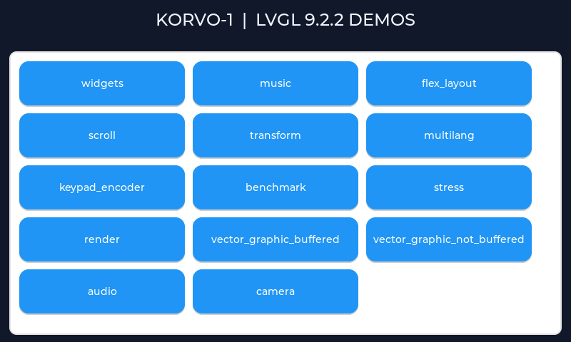

# Korvo-1 주변 장치와 LVGL 사용 안내

## 현재 구성

Windows의 COM3 UART 또는 Wi-Fi SSH로 접속합니다. Linux root filesystem은 microSD의 ext4 파티션이며, NOR Flash에는 부트로더·Hart 0 무선 펌웨어·OpenSBI·Linux kernel을 저장합니다. 현재 보드는 기본 사양의 OV3660 대신 **SC101IOT** 카메라가 장착되어 있습니다. 실제 I²C 주소 `0x68`, 칩 ID `0xDA4A`를 읽어 확인했습니다. 드라이버는 OV3660(`0x3c`, ID `0x3660`)과 SC101IOT를 자동 판별합니다.

### Wi-Fi 자동접속

부팅 서비스 `/etc/init.d/S40wifi`는 `/etc/wpa_supplicant.conf`에 저장된 여러 SSID를 사용합니다. 인터페이스가 늦게 나타나는 경우도 기다리고, supplicant나 DHCP 프로세스가 종료되면 다시 시작합니다. AP가 사라졌다가 돌아오면 wpa_supplicant가 저장된 네트워크를 다시 선택합니다. 서비스 감시 주기는 10초입니다. 실제 AP 재검색 간격과 재접속 시간은 인증 상태와 wpa_supplicant에 따라 달라집니다.

네트워크 추가는 보드에서 실행합니다. 암호는 숨김 입력되며 셸 명령 이력에 남지 않습니다.

```sh
wifi-add '네트워크 이름' 10
```

우선순위 숫자가 큰 네트워크를 선호합니다. 다른 SSID도 같은 명령으로 추가할 수 있습니다. 같은 SSID가 이미 있으면 중복 추가를 거부하므로 기존 `/etc/wpa_supplicant.conf` 블록을 수정한 뒤 서비스를 재시작하세요.

```sh
/etc/init.d/S40wifi restart
/etc/init.d/S40wifi status
iw dev wlan0 link
ip -4 addr show wlan0
```

설정 파일은 microSD ext4의 `/etc`에 권한 `600`으로 저장됩니다. `/tmp`에 저장하면 재부팅 후 사라집니다. 기존 `/mnt/sd/wpa_supplicant.conf`가 있고 `/etc`에 네트워크가 없으면 서비스가 한 번 가져옵니다. 새 SD 이미지를 카드 전체에 다시 기록하면 기존 ext4 설정도 사라지므로, 이미지 재기록 전 설정과 SSH 키를 별도로 백업해야 합니다. 공개 이미지에는 개인 Wi-Fi 프로필이나 SSH 개인키를 넣지 않습니다.

### LCD 제어

`/proc/fb`에서 `esp32s31-rgb`가 보이면 native LCD driver입니다. 이 드라이버는 RGB565 800×480의 클럭·sync/porch 타이밍·AXI DMA descriptor ring을 Linux에서 설정합니다. `/dev/fb0`를 사용하므로 기존 LVGL fbdev 프로그램도 실행할 수 있습니다.

```sh
lcdctl status
lcdctl off
lcdctl on
lcdctl restart
lcdctl clock 16
lcdctl clock 18
lcdctl color red
lcdctl color green
lcdctl color blue
lcdctl color off
```

`off`는 검은 프레임을 전송한 뒤 RGB scanout을 정지하고, `on`은 descriptor ring을 다시 구성해 화면을 복원합니다. `restart`는 이 과정을 수행하며 framebuffer 내용은 유지합니다. `color`는 LCD DMA가 framebuffer 대신 예약 메모리의 단색 RGB565 타일을 반복해서 읽도록 전환합니다. LVGL이 계속 그려도 단색 화면을 유지하며, `lcdctl color off`로 현재 GUI 표시로 돌아옵니다. 타일은 framebuffer 예약 영역의 사용하지 않던 4KiB를 사용하므로 별도 RAM 할당이나 화면 내용 덮어쓰기가 없습니다. `lcdctl status`의 `DMA source`는 SRAM descriptor와 타일을 실제로 읽어 `solid 0xf800`(빨강) 또는 `framebuffer`를 표시합니다.

이전 구현에서는 RGB blank 구간 활성화 비트(`LCD_BK_EN`)가 빠져, 자동 다음 프레임이 설정되어도 LCD가 한 프레임 뒤 멈췄습니다. 따라서 debug-data 레지스터에 색상을 써도 화면이 갱신되지 않았습니다. blank 구간을 활성화해 반복 VSYNC와 DMA 진행을 확인했으며, 색상 테스트도 정상 DMA 경로로 변경했습니다. `lcdctl status`의 `Refreshing: 1`은 LCD 엔진의 실제 START 비트가 켜져 있음을 뜻합니다. 설정값 읽기와 실제 화면 갱신은 서로 다른 검증입니다.

PCLK 기본값은 기존 부트로더와 같은 약 18MHz입니다. `fbset`으로 고정 해상도의 porch와 sync 길이도 설정할 수 있지만 패널에 맞지 않는 값은 정상 영상을 보장하지 않습니다.

이 서브보드는 별도 백라이트 밝기 제어 핀이 없고, 공식 BSP의 brightness 함수도 `ESP_ERR_NOT_SUPPORTED`를 반환합니다. `lcdctl off`는 백라이트 전원을 차단하는 기능이 아닙니다. 물리적인 밝기 조절에는 별도의 하드웨어 연결이 필요합니다.

### 카메라

카메라 모듈은 부팅 서비스 `/etc/init.d/S55camera`가 로드합니다. 커널은 V4L2/videobuf2를 microSD의 모듈로 제공하며 `korvo_camera.ko`가 센서와 LCD_CAM 수신부를 연결합니다. SC101IOT는 8MHz XCLK, 중앙 240×240 crop, YUYV 출력을 사용합니다. OV3660 경로는 20MHz XCLK와 RGB565 big-endian 출력을 사용하며, 현재 장착된 보드에서는 SC101IOT 경로를 검증했습니다.

```sh
ls -l /dev/video0
cat /var/log/camera.log
korvo-camera /mnt/sd/photo.ppm
korvo-camera --preview 10
```

사진은 PPM(RGB) 파일로 저장됩니다. 호스트에서 이미지 뷰어로 열거나 다른 형식으로 변환할 수 있습니다. `--preview`는 framebuffer를 직접 사용하므로 LVGL과 동시에 실행하지 마세요.

```sh
/etc/init.d/S97lvgl-music-demo stop
korvo-camera --preview 10
/etc/init.d/S97lvgl-music-demo start
```

DMA frame buffer는 작은 coherent page 여러 개로 구성해 128KiB 연속 메모리 할당을 피합니다. Descriptor는 HP SRAM의 `0x2F079C00`부터 1KiB 예약 영역을 사용합니다. LCD는 `0x2F079000`부터 앞 3KiB를 사용하며, AXI TX0와 RX1 채널을 각각 전용으로 사용합니다. 다른 AXI DMA 사용자를 추가할 때 이 채널과 SRAM 영역을 중복 사용하면 안 됩니다.

처음 시작하거나 스트림을 멈출 때 불완전한 프레임은 폐기합니다. 완전한 프레임만 저장·표시하며, 캡처 오류는 `dmesg`에 기록합니다. 센서 ID 검출 실패 시 가짜 `/dev/video0`를 만들지 않습니다. SC101IOT는 이 구성에서 JPEG를 직접 출력하지 않으므로, 정지 사진은 YUYV를 RGB로 변환해 저장합니다.

### LVGL 공식 데모 선택 메뉴

부팅하면 `/usr/bin/korvo-ui menu`가 실행됩니다. 터치로 데모를 고르고 우측 상단 `HOME`으로 돌아옵니다. 데모를 바꿀 때 프로세스를 새로 시작해 이전 데모의 타이머와 메모리가 남지 않도록 했습니다.



`camera`를 누르면 실시간 영상과 프레임 수가 나타납니다. `SAVE PHOTO`는 현재 프레임을 `/mnt/sd/camera-시간값.ppm`에 저장합니다. 실제 보드에서 메뉴 선택, 영상 갱신, 사진 파일 생성, `HOME` 복귀를 확인했습니다. GUI 실행 중에는 Linux 콘솔을 graphics 모드로 전환해 콘솔 글자가 화면 위에 덮이지 않도록 합니다.

```sh
korvo-ui --list
/etc/init.d/S97lvgl-music-demo restart
```

직접 특정 데모를 실행하려면 먼저 자동 실행 서비스를 멈춥니다.

```sh
/etc/init.d/S97lvgl-music-demo stop
korvo-ui widgets
# Ctrl+C로 종료한 뒤 메뉴 복귀
/etc/init.d/S97lvgl-music-demo start
```

| 실행 이름 | 기능 |
|---|---|
| `widgets` | LVGL 위젯 종합 화면 |
| `music` | 공식 음악 플레이어 UI와 애니메이션 |
| `flex_layout` | Flex 배치 예제 |
| `scroll` | 스크롤 동작 예제 |
| `transform` | 위젯 변환 예제 |
| `multilang` | 다국어 글꼴·텍스트 예제 |
| `keypad_encoder` | 키보드·엔코더 포커스 예제; USB 키보드 사용 가능 |
| `benchmark` | 렌더링 성능 측정 |
| `stress` | 위젯·애니메이션 부하 시험 |
| `render` | 렌더링 장면을 5초마다 순서대로 표시 |
| `vector_graphic_buffered` | 벡터 그래픽을 버퍼에 렌더링 |
| `vector_graphic_not_buffered` | 벡터 그래픽 직접 렌더링 |
| `audio` | 별도 Korvo 음악 UI와 ALSA 실제 재생 경로 |
| `camera` | 카메라 미리보기와 microSD 사진 저장 |

공식 LVGL 9.2.2에 들어 있는 데모 11종을 모두 포함하며, 벡터 데모는 2가지 실행 방식으로 나뉩니다. 공식 `music`은 음악 플레이어 모양의 UI 데모입니다. 실제 소리 재생용 Korvo UI는 `audio`입니다. 마이크 녹음과 스피커의 실제 음량·음질 확인은 별도 검증 대상입니다.

### 메뉴 전환과 네이티브 해상도 성능

LVGL fbdev 포트는 새 데모를 실행할 때마다 UNBLANK를 요청합니다. 이미 켜진 RGB/DMA 엔진을 이 요청마다 다시 초기화하던 문제를 수정했습니다. 상태가 같으면 초기화하지 않으며, RGB transfer buffer를 켜고 실제 DMA FIFO 데이터가 준비된 뒤 출력을 시작합니다. 사용자가 메뉴와 데모 화면의 실제 표시를 확인했습니다.

출력과 UI 렌더링 모두 **800×480**을 유지합니다. CPU 소프트웨어 렌더링의 비용을 줄이기 위해 다음을 적용했습니다.

- RGB565 부분 렌더링 버퍼: 60행 96KiB → 20행 32KiB. 64KiB D-cache에 스타일·폰트 데이터가 함께 들어갈 여지를 확보합니다.
- 스타일 속성 캐시, 64×64 그림자 캐시, 이미지 헤더 16개 캐시 활성화. 해상도나 데모 효과를 제거하지 않습니다.
- 터치 확인 주기와 GUI의 최대 대기 시간을 10ms로 조정합니다.
- 렌더링 중 쌓인 터치의 누름·뗌을 각각 SYN_REPORT 단위로 전달합니다. 이전처럼 마지막 RELEASED 상태로 합쳐져 짧은 클릭이 사라지지 않습니다.
- 데모 전환과 ALSA 실행 시 불필요한 파일 핸들을 close-on-exec로 정리합니다. GUI 서비스는 종료를 기다린 뒤 재시작합니다.
- audio의 HOME 복귀 후에도 다음 데모를 실행할 수 있도록, 실행 경로는 `argv[0]` 대신 `/proc/self/exe`로 확인합니다.

같은 계측 코드로 음악 데모의 실제 화면 갱신 20회를 비교한 한 구간에서, 처리 시간은 2,880ms → 2,359ms(약 18% 감소), framebuffer 복사 시간은 1,029ms → 781ms였습니다. 대기까지 포함한 구간 시간은 4,822ms → 4,244ms였습니다. 빈 갱신 요청은 집계에서 제외합니다. 이는 해당 데모 시작 구간의 측정값이며 모든 화면의 FPS를 보장하지 않습니다. 복잡한 효과를 포함한 800×480 화면은 단일 CPU 소프트웨어 렌더링의 제약을 받습니다.

계측이 필요할 때만 다음처럼 실행합니다. 기본 메뉴에서는 로그 계측을 하지 않습니다.

```sh
/etc/init.d/S97lvgl-music-demo stop
KORVO_UI_STATS=1 korvo-ui music 15
/etc/init.d/S97lvgl-music-demo start
```

`tests/ui-event-replay.c`와 `tests/check-ui-input.sh`는 보드의 실제 evdev 경로로 짧은 터치를 재생하는 통합 검사입니다. GUI를 잠깐 정지해 누름·뗌이 모두 큐에 쌓이도록 한 뒤 재개하여, widgets 진입과 HOME 복귀 및 audio → HOME → camera → HOME을 확인합니다. C 도구를 대상용 toolchain으로 빌드해 `/tmp/ui-event-replay`에 복사한 뒤 보드에서 셸 검사를 실행합니다. 이 검사는 화면을 조작하므로 다른 GUI 작업과 동시에 실행하지 않습니다.

보드 RAM이 작아 `/etc/init.d/S07disk-swap`가 ext4에 32MiB swap 파일을 생성합니다. 복잡한 데모는 PC보다 느리며 swap 사용량에 따라 응답 시간이 늘어날 수 있습니다. swap은 저장 용량을 RAM으로 바꾸는 기능이 아니며, 동시에 여러 GUI를 실행하는 용도로 사용하지 않습니다.

## 소스와 빌드 위치

| 경로 | 역할 |
|---|---|
| `linux/drivers/video/fbdev/esp32s31-fb.c` | native LCD driver |
| `linux/arch/riscv/boot/dts/espressif/esp32s31_korvo1.dts` | 핀·메모리·컨트롤러 연결 |
| `korvo-addons/package/korvo-camera/src/` | V4L2 모듈, 센서 테이블, 캡처 도구, 색상 변환 |
| `korvo-addons/package/korvo-ui/src/` | LVGL 메뉴와 Linux fbdev/evdev 포트 |
| `korvo-addons/package/lvgl/` | LVGL 9.2.2 Buildroot 패키지와 전체 데모 설정 |
| `korvo-addons/rootfs/` | Wi-Fi, LCD, swap, 카메라와 GUI 시작 스크립트 |

`build-korvo-wsl.sh`가 이 디렉터리를 고정 레퍼런스 트리에 복사하고 defconfig를 재생성합니다. 패키지나 커널 오버레이가 바뀌면 관련 빌드 캐시를 갱신합니다. 최신 microSD 이미지를 새 카드에 기록하면 필요한 모듈과 도구가 함께 설치됩니다. 기존 카드에는 개인 설정을 보존하면서 실행 파일·모듈·서비스만 업데이트할 수도 있습니다.

## 참고한 원본 프로젝트

- [LVGL v9.2.2 공식 데모](https://github.com/lvgl/lvgl/tree/v9.2.2/demos)
- [Espressif SC101IOT 드라이버](https://github.com/espressif/esp32-camera/blob/master/sensors/sc101iot.c)
- [Espressif SC101IOT 초기화 테이블](https://github.com/espressif/esp32-camera/blob/master/sensors/private_include/sc101iot_settings.h)
- [Espressif OV3660 드라이버](https://github.com/espressif/esp-video-components/blob/master/esp_cam_sensor/sensors/ov3660/ov3660.c)
- [Espressif S31 camera low-level 드라이버](https://github.com/espressif/esp-idf/blob/master/components/esp_hal_cam/esp32s31/include/hal/cam_ll.h)
- [Espressif Korvo-1 LCD BSP](https://github.com/espressif/esp-bsp/blob/master/bsp/esp32_s31_korvo_1/src/bsp_display.c)
